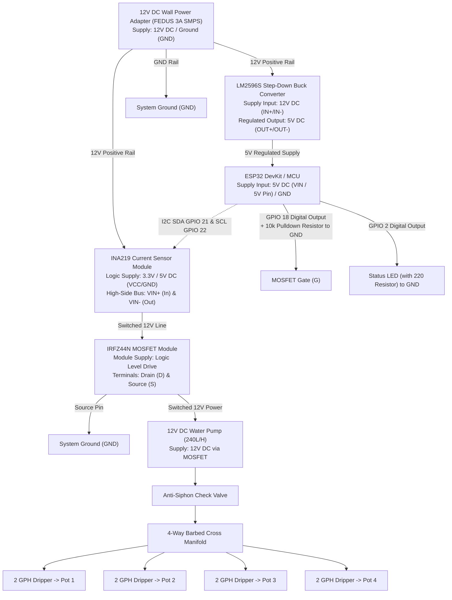

# Plant Watering System - Detailed Electrical Circuit Schematic

This document provides a comprehensive Mermaid schematic and pinout mapping for the 12V Automated Plant Watering System (FSD v2.0).

---

## 1. System Power & Signal Architecture (Mermaid Diagram)

---

## 2. Component Pinout, Power Requirements & Interfacing Reference Table

| Component | Operating Power Supply | Pin / Terminal | Connects To | Purpose / Notes |
| :--- | :--- | :--- | :--- | :--- |
| **12V Wall Adapter** | Mains AC to 12V DC (2A–3A) | Positive (+) / GND | Buck Converter, INA219, Pump | Primary system energy source. |
| **LM2596S Buck Converter** | Input: 4.5V–40V (uses 12V)   Output: 5V Regulated | IN+ / IN-   OUT+ / OUT- | 12V Adapter (+) / GND   ESP32 VIN / GND | Steps down 12V to stable 5V logic power for ESP32. |
| **INA219 Current Sensor** | Logic Supply: 3.0V–5.5V DC   Bus Voltage: 0V–26V DC | VCC   GND   VIN+   VIN-   SDA / SCL | ESP32 3.3V/5V   System GND   12V Adapter (+)   MOSFET Drain (D)   ESP32 GPIO 21 / 22 | Monitors high-side motor current over I2C for dry-run protection. |
| **IRFZ44N MOSFET Module** | Logic Gate: 3.3V / 5V   Load: 12V DC | Gate (G)   Drain (D)   Source (S) | GPIO 18 & 10k Pulldown   INA219 VIN-   Pump (-) & System GND | Fully saturates at 3.3V logic to switch 12V power to the pump. |
| **ESP32 Microcontroller** | Input: 5V DC (VIN) or 3.3V | VIN / 5V   GND   GPIO 18   GPIO 2   GPIO 21 / 22 | Buck 5V Output   System GND   MOSFET Gate   Status LED   INA219 SDA/SCL | Central controller managing timing, NVS, Wi-Fi telemetry, and OTA. |
| **12V Water Pump (240L/H)**| 12V DC (Submersible) | Positive (+)   Negative (-) | MOSFET Switched 12V   System GND | Pumps water reservoir through manifold. |
| **Anti-Siphon Check Valve** | Passive Hydraulic | Inlet / Outlet | Pump Outlet & Manifold | Prevents back-siphoning when idle. |
| **4-Way Barbed Cross & Drippers** | Passive Hydraulic | Barbed Ports | Check Valve & 4x Dripper Tubing | Balances distribution (~125ml per pot). |
